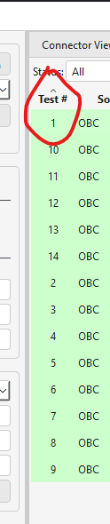

# TODOs:

##### 1. Commit the updated code

2. ADD I2PL IST MK-0 for the USB ID
3. Need to remove test id column, form result window:
   
4. Keep test type first:
5. Need to remove the resistance section from the result for MK0.
